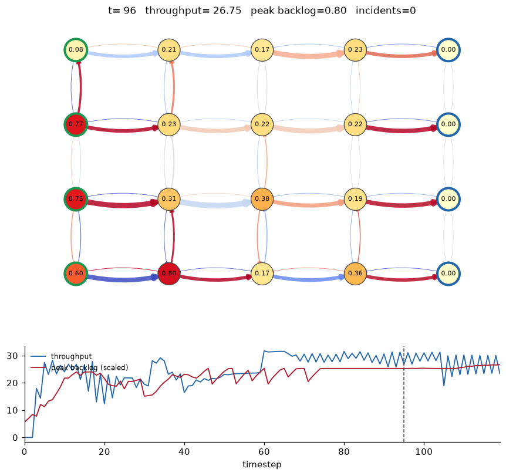
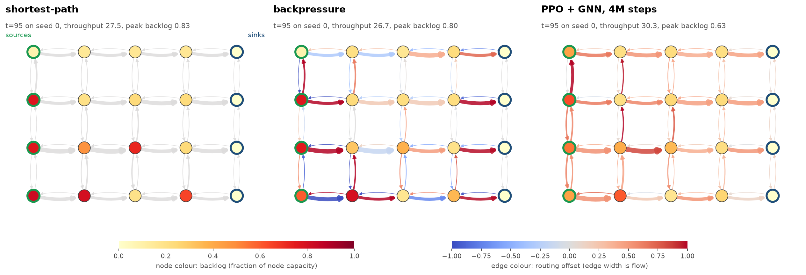
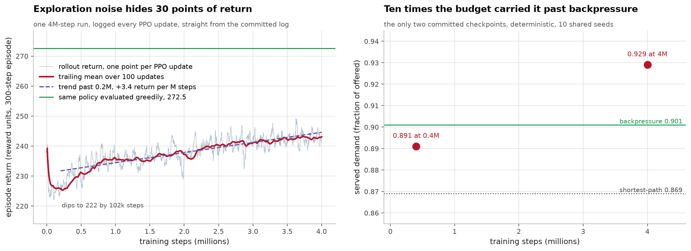
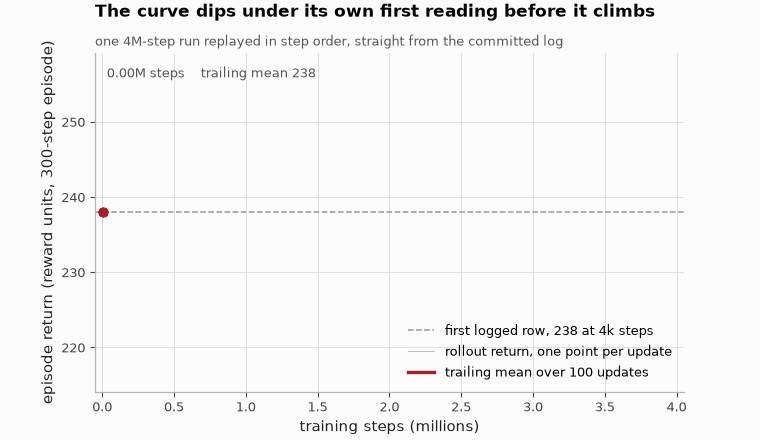
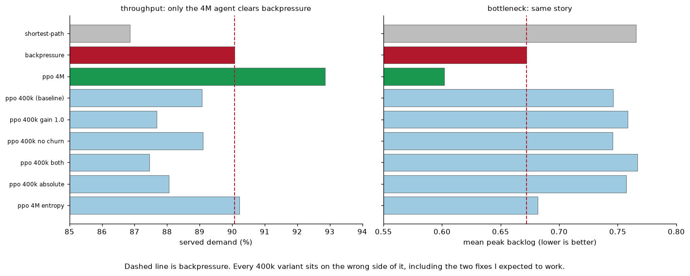
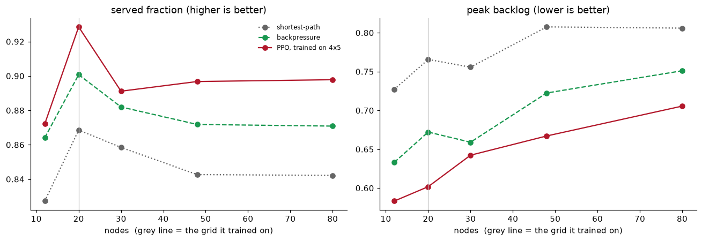
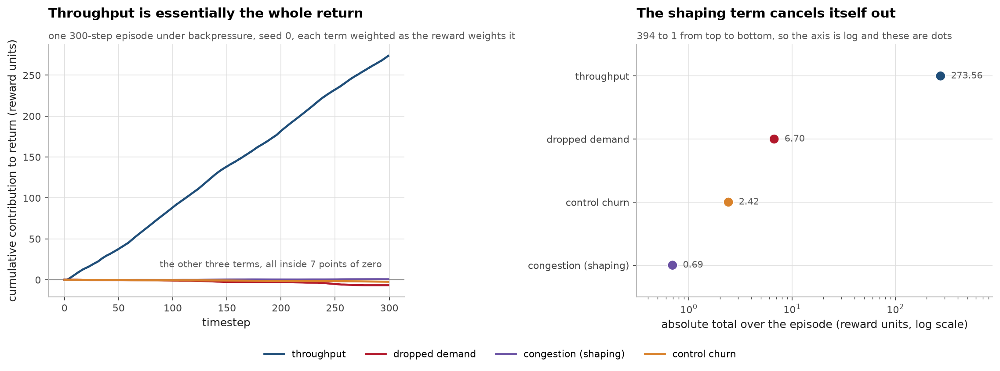

# Dynamic Graph Network Optimizer

**Can a GNN policy learn routing control that beats backpressure, and does it transfer to graphs it never saw?**

[](https://github.com/aghasalim/dynamic-graph-optimizer/actions/workflows/ci.yml)
[](LICENSE)
[](https://doi.org/10.5281/zenodo.23003620)



<sub>The trained agent mid-episode. Node colour is backlog, green borders are
sources and blue are sinks; edge width is flow and edge colour is the routing
offset.</sub>

I picked routing on a spatial network, with demand that changes over time and
links that fail at random. It's a control problem with a strong classical baseline.
Backpressure scheduling is throughput-optimal for this kind of queueing network, and
you get it in closed form by minimising the drift of a quadratic Lyapunov function.
So there's a real bar to beat, and it's not easy.

The short answer is yes on four of five metrics, and yes, it transfers. It took ten
times the training budget I expected. I also tried two fixes that seemed sensible,
and both made things worse. I've included those too.

---

## The scoreboard

At 4M steps the agent beats backpressure on four of the five metrics I score.
The summary is 0.929 served against 0.901, 0.047 dropped against 0.075, and
0.602 mean peak backlog against 0.672. On the fifth it loses, since its
mean backlog over all nodes is 0.268 against 0.262. So it keeps the worst node down
but carries a bit more queue everywhere else.

I ran 10 eval episodes on shared seeds. `served` is delivered over offered demand.
`peak_q` is the episode mean of the worst node's backlog. `churn` is how much the
action moves per step.

Because the seeds are shared, I can also take the difference episode by episode.
`docs/paired-returns.txt` has each policy's return minus backpressure's, with a 95%
bootstrap interval over the 10 seeds. The 4M agent's interval is well above zero.
The 400k baseline's covers zero, so on return it is a tie with backpressure, not a loss.

Put another way, the 4M agent serves 0.929 of offered demand against backpressure's 0.901.
It drops 0.047 against 0.075, and holds the worst node at 0.602 against 0.672. Its
churn is 0.0155 against backpressure's 0.1994, so it does this while moving the
routing weights about an order of magnitude less. Mean backlog over all nodes is
the column it loses, 0.268 against 0.262.






*The 4M run replayed in step order. The dashed line is its own first reading
at 4k steps. The curve stays below it for a long time before it climbs back
past.*

Detail in [notes/METHODS.md](notes/METHODS.md#21-against-the-baselines).

## The two fixes that made it worse



I expected two fixes to work, and neither did. Raising the action head gain to
1.0 at 400k made it worse (0.877 served, 0.759 peak backlog against the 400k
baseline's 0.891 and 0.746). Removing the churn penalty changed nothing to three
decimals. Adding an entropy bonus at 4M gave 0.902 served against the plain run's 0.929.
In the end what fixed it was ten times the training budget.

## It holds up on grids four times the size

I trained on 4x5 and evaluated on other sizes without retraining. `sp` is
shortest-path and `bp` is backpressure.

On 8x10 there are four times the nodes and 4.6 times the edges of the training
grid. It still serves 0.898 against backpressure's 0.871 and keeps peak backlog at 0.706
against 0.751. The margin doesn't shrink with size, but it isn't flat either. The
widest served gap is +0.028 on the 4x5 grid it trained on. The
narrowest is +0.008 on 3x4, and then it goes back to +0.027 on 8x10.



It transfers because I kept the policy permutation-equivariant. Moving the policy
to a new grid copies 113 of its 117 tensors. In other words, 113 of 117 tensors copy
across a change of topology, and the four that do not are `edge_index` buffers and `log_std`.
That comes from swapping SB3's dense action layer for an equivariant head. The
transfer table is the experiment that shows the swap was worth it.

Detail in [notes/METHODS.md](notes/METHODS.md#22-transfer-to-other-grid-sizes).

## What the reward is actually made of

I wrote the congestion term as potential-based shaping, `gamma*Phi(s') - Phi(s)`,
so it's policy-invariant. `tests/test_dgno.py` checks the telescoping property
directly.

That has a cost, which you can see in the figure below. Since the term telescopes,
over a 300 step episode throughput accumulates 273.6 of return while the shaping
term sums to 0.69, a factor of about 400. So it helps with credit assignment but
hardly pushes the agent to flatten backlog on its own. Routing is a softmax over
each node's out-edges. At zero action that's plain shortest-path, so the agent
starts from something that works and corrects it.



Detail in [notes/METHODS.md](notes/METHODS.md#4-method).

---

## Running it, without the four hours

```bash
pip install -e .
python tests/test_dgno.py
python -m dgno.visualize --policy backpressure --steps 150
```

The agent behind both tables is committed at `checkpoints/ppo-gnn-4m.zip` (1.1 MB),
so you don't have to spend the four hours retraining it:

```bash
python tests/test_checkpoint.py
```

That reloads it and re-runs the evaluation against both baselines. It fails if
the agent stops beating backpressure on throughput or peak backlog, or drifts back
towards a static policy. It runs in CI, so the numbers above get re-derived on every
push. The code in `verify/` also re-derives them separately from the recorded per
episode data, and CI fails if anything disagrees.

I committed the ablation agents too, under `checkpoints/ablations/`. You can
re-derive every ablation number above in about 15 seconds.

```bash
python -m dgno.ablations
```

It scores every agent with the same reward and seeds, so `return` can be compared
across rows there. That's not true of the per-run files in `docs/`, since each one
uses the reward its own agent was trained on.

If you want to retrain from scratch, run `python -m dgno.train --timesteps 4000000`.
It takes about four hours on 8 CPU envs.

## Where the files are

```
dgno/simulator.py   queueing dynamics, demand, incidents, spillback
dgno/env.py         Gymnasium wrapper, observations, reward
dgno/models.py      GATv2 encoder, SB3 extractor, policy
dgno/baselines.py   shortest-path, backpressure, evaluation
dgno/train.py       PPO config and entry point
dgno/transfer.py    re-host a trained policy on a different grid
dgno/ablations.py   re-derive the ablation table from the checkpoints
checkpoints/        the 4M agent and the six ablation agents
dgno/visualize.py   episode animation
dgno/figures.py     regenerate the figures in this README
tests/test_dgno.py  invariants, batching, shaping telescoping
tests/test_checkpoint.py  re-derives the reported numbers from the checkpoint
verify/export.py    writes the per episode fixture and the recorded draws
verify/data/        that fixture, regenerated and diffed in CI
verify/simulate.c   the simulator and both baselines again, in C
verify/gocheck/     structural and cross table validation, in Go
verify/summary.sql  the published means again, in SQLite
verify/verify.R     the means again plus paired intervals, in base R
verify/permute/     the exact randomisation test and a paired bootstrap, in Rust
verify/readme_audit.js  every number in this README against its source file
verify/verify.sh    runs all six and exits non-zero on any disagreement
```

## Where the simulator is unrealistic

Spillback rationing is single-pass, so a throttled node can leave its upstream
slightly over-served within the same tick. It fixes itself on the next tick.

Flow is a fluid with no discrete vehicles, and the agent sees the state with no
delay. In a real network that delay is probably where most of the difficulty is.

## The four papers this leans on

- **Veličković, Cucurull, Casanova, Romero, Liò, Bengio. Graph Attention Networks. ICLR 2018.** [arXiv:1710.10903](https://arxiv.org/abs/1710.10903) the GAT state encoder.
- **Schulman, Wolski, Dhariwal, Radford, Klimov. Proximal Policy Optimization Algorithms. 2017.** [arXiv:1707.06347](https://arxiv.org/abs/1707.06347) the control policy.
- **Fey, Lenssen. Fast Graph Representation Learning with PyTorch Geometric. 2019.** [arXiv:1903.02428](https://arxiv.org/abs/1903.02428) the graph library.
- **Raffin, Hill, Gleave et al. Stable-Baselines3. JMLR 22, 2021.** the PPO implementation.
